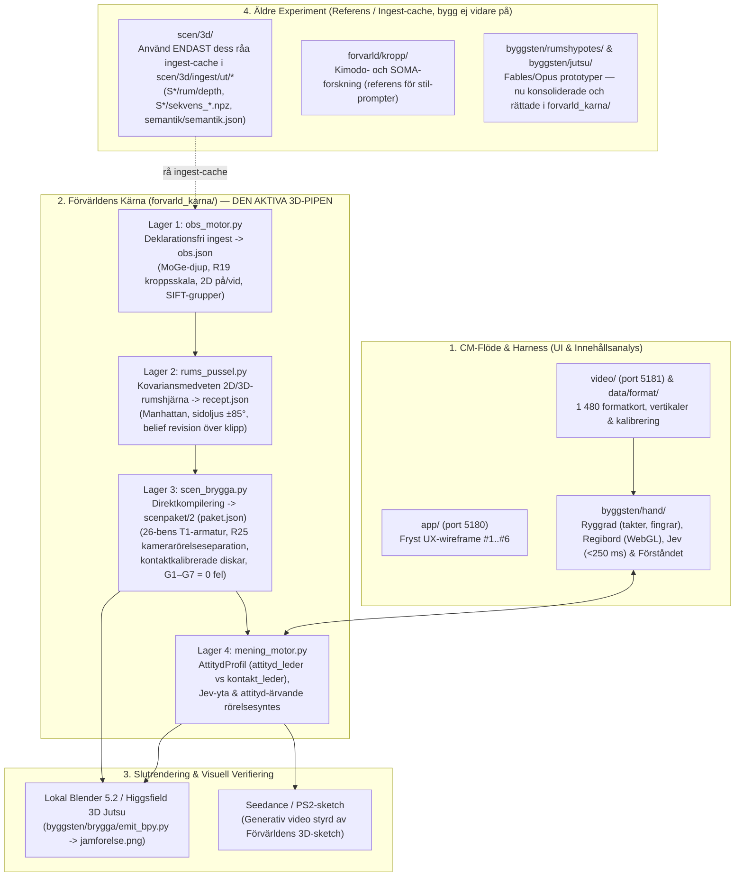

# LÄGE & DEKLARATION (19 nov 2026) — Hur `hagen-wf` Hänger Ihop och Vart Vi Är På Väg

> **Snabbstart för kommande agent:**  
> Läs detta dokument först. Det förklarar helhetsbilden bakom alla experiment i `hagen-wf`, vilka sidospår som har frysts eller ersatts, och var den nu verifierade kärnpipelinen bor (**[`forvarld_karna/`](forvarld_karna/ARKITEKTUR.md)**).

---

## 1. Vad är slutmålet? (LeTrend, Kreativ Bricolage & Förvärlden)

Allt arbete i `hagen-wf` tjänar **ett** övergripande syfte: att bygga de tekniska kärnflödena som ska lyftas in i huvudappen **LeTrend (`../hagen-ui`)** för en specifik användare — en **Content Manager (CM)**.

1. **Kreativ bricolage på riktigt innehåll:**  
   Ungdomar och kreatörer laddar in *riktigt* innehåll (9:16-klipp som fungerar på riktigt i sociala kanaler). En tränad **innehållsharness** (`data/format/`, `video/format/`, `byggsten/hand/`) läser *varför* klippet fungerar (premiss, krok, vändning, takter, räckvidd/fingrar) och guidar CM i att planera och anpassa innehållet till en specifik verksamhets (kunds) linje och förmåga.
2. **1:1-nedbrytning till "Förvärlden" (utan generativ AI i analysledet):**  
   För att CM ska kunna ändra en scen semantiskt (*"låt kunden gå genom lokalen fram till bardisken med samma slappa attityd i stället för att sitta"*, eller *"låt henne skopa och räcka fram med andra handen"*) måste originalvideon först brytas ner 1:1 till en lättviktig, blocky 3D-värld — **Förvärlden**:
   - Kamerans position, vinkel, brännvidd (FOV), inåkning/panorering och hårda klipp (`shots`).
   - Lokalens sannolika 3D-layout (golvplan, väggar, kontaktkalibrerade bord/diskar, stolar, rekvisita).
   - Personernas identitet över klipp, synlighet, 3D-kroppsrörelser (`T1`-skelett med 26 ben) samt deras destillerade **fysiska attitydprofil** (rygglutning, slapphet, tempo, blickfokus, kontaktbundna vs attitydbärande leder).
   - Tidslinjens repliker och takter.
3. **Snabb semantisk manipulation (< 250 ms via Jev) + Illustrativ slutrendering (Seedance / PS2-sketch):**  
   - **Ingest får ta tid** som en engångsinsats när ett klipp laddas in.
   - **Live-manipulering för CM måste vara blixtsnabb:** När klippet väl är nere i ett ~100–250 KB `scenpaket/2` (`paket.json`) ska CM inte sitta i Blender, utan styra scenen semantiskt via **Jev** (< 250 ms action-filtrering över förberäknade lagliga drag) eller **Förståndet** (LLM som kompilerar nya recept).
   - När kroppen ändrar handling i `scenpaket/2` **ärver den personens inlästa attityd** samtidigt som **originalets kamerakomposition och bildutsnitt hedras**.
   - Först när den manipulerade förvärlden är låst skickas 3D-sketchen + originalets komponenter som styrning till en generativ videomodell (**Seedance** eller illustrativ PS2-sketch) som fyller i ytdetaljerna utan att tappa rummet eller kompositionen.

---

## 2. Karta över Repots Delar — Vad gäller och vad är historia?

Under två veckor har flera experimentgrenar vuxit fram. Så här förhåller de sig till varandra idag (19 nov 2026):



### Sammanfattning per katalog i roten

| Katalog | Status (19 nov 2026) | Roll i helheten & instruktion till nästa agent |
|---|---|---|
| **[`forvarld_karna/`](forvarld_karna/ARKITEKTUR.md)** | **AKTIV KÄRNA (Verifierad)** | **Här bor den riktiga 4-lagerspipen** från råvideo-ingest till `scenpaket/2`, kvalitetsgrindar `G1–G7` och attityd-ärvande semantisk manipulation. All fortsatt 3D-/förvärldsutveckling ska ske här. |
| **[`byggsten/brygga/`](byggsten/brygga/)** | **AKTIV HJÄLPMODUL** | Innehåller `grindar.py` (`G1–G7`), `emit_bpy.py` (kompilerar `paket.json` till 30 KB Blender/Jutsu-Python med 26-bens `T1`-armaturer) och `rotation.py`. Anropas direkt av `forvarld_karna/scen_brygga.py`. |
| **[`byggsten/hand/`](byggsten/hand/)** | **AKTIV HARNESS-BRYGGA** | Kopplar formatkorten (`1 480` klipp) till ryggrad (`ryggrad.py`), kundlinje (`anpassa.py`), Jev-yta (`tillstand.py`), Förståndet (`forstand.py`) och ett interaktivt WebGL-regibord (`bord/index.html`). Ska kopplas ihop 1:1 med `forvarld_karna/mening_motor.py`. |
| **[`video/`](video/) & [`karta/`](karta/README.md)** | **AKTIV (UI & Format)** | Videovertikaler, formatkort och CM-flödets kartläggning inför `../hagen-ui`. Rör inte layouten i `video/` utan uttrycklig instruktion. |
| **[`scen/3d/`](scen/3d/PIPE.md)** | **ARKIVERAD LOGIK / AKTIV RÅCACHE** | Den gamla 40-skriptskedjan (`plats.py`, `hand.py`, `inpassning.py`, handskrivna `deklaration.json`) hade klipp-specifika patchar och är **ersatt av `forvarld_karna/`**. **VIKTIGT:** Katalogerna under `scen/3d/ingest/ut/<klipp>/` innehåller den råa per-tagnings-ingesten (`S*/rum/depth/*.npz`, `S*/sekvens_*.npz`, `semantik/semantik.json`) som `forvarld_karna` läser! |
| **[`forvarld/kropp/`](forvarld/kropp/KARTA.md)** | **FORSKNINGSREFERENS** | Kartläggning av SAM 3D Body vs Kimodo-SOMA-RP och kontaktsignaturer (`0039`–`0045`). Insikterna är nu inbakade direkt i `forvarld_karna/mening_motor.py`. |
| **[`app/`](app/)** | **FRYST** | Tidig wireframe på `localhost:5180`. Rörs inte. |

---

## 3. Vad vi har bevisat och verifierat i `forvarld_karna/`

Det fullständiga arkitekturdokumentet och obduktionen finns i **[`forvarld_karna/ARKITEKTUR.md`](forvarld_karna/ARKITEKTUR.md)**. Här är kärnresultaten som nu är låsta och reproducerbara med ett enda kommando:

```powershell
$env:PYTHONIOENCODING="utf-8"
.\scen\.venv\Scripts\python.exe forvarld_karna\verifiera.py --klipp alla --utan-deklaration
.\scen\.venv\Scripts\python.exe forvarld_karna\mening_motor.py
```

### 3.1 Löst 3D-rumspussel över 4 helt olika riktiga klipp (utan handskriven `deklaration.json`)
Genom att rätta fyra matematiska buggar i Fables prototyp (horisontell 2D-projektion för `pa`/`vid`, sidoljus `±85°`, kovariansmedveten grindning när en vidvinkel kopplar ihop tidigare frikopplade delgrafer, samt bålcentrerat 3D-djup `c_spine2` i stället för MHR-fotorigo `cam_t_ra`) och lägga till MoGe-ytnormaldetektion av diskar/bord när YOLO ger `objects=[]`:
- **`notan` (`S1–S7`):** Kopplar ihop A:s bord `bord_1` (`['s1', 's3', 's6', 's7']`), den gula Bonaqua-burken `foremal_1` (`['s1', 's3', 's6', 's7']`) och B:s bord `bord_2` (`['s2', 's5', 's7']`). Avståndet `A <-> B` går från gamla `6.80 m` till **`2.85 m`** (`P = 1.00`).
- **`guacamole` (`S1–S4`):** Detekterar bardisken `bord_1` ur MoGe-normalerna och kopplar ihop den över **alla 4 tagningar `['s1', 's2', 's3', 's4']`** mellan kund `A` (sitter) och bartender `B` (står), inklusive tvåpersonsvinkeln i `S4` (`P = 0.98`).
- **`gelato` (`S1–S2`):** Kopplar ihop glassdisken `bord_1` och `A` över 90°-kameravinkelbytet `['s1', 's2']` (`P = 1.00`).
- **`asketch` (`S1–S7`):** Filtrerar bort 14 000 m MoGe-outlier, hanterar den personlösa B-roll-närbilden `S6` och placerar hela dialogen i ett sammanhängande gatuköksrum (`P = 0.86`).

### 3.2 Direktkompilering till `scenpaket/2` med 0 fel på samtliga kvalitetsgrindar (`G1–G7`)
- **[`forvarld_karna/scen_brygga.py`](forvarld_karna/scen_brygga.py)** kompilerar `recept.json` + råa `S*/sekvens_*.npz` direkt till `scenpaket/2` (`paket.json`) med 26-bens `T1`-armaturer:
  - **Regel `R25_separera_kamerarorelse`:** Separerar kamerans inåkning/panorering (t.ex. `1.09 m` drift i `gelato S1`) från kroppens bäcken och lägger den som kameranycklar på `CAM_s1` (`statisk = False`) med **0 px 2D-avvikelse (`IoU = 1.000`)**.
  - **Kontaktkalibrerade möbler:** Kalibrerar bords-/diskhöjd (`topp_z`) mot skådespelarnas vilande armbågar/handleder och håller dolda ben utanför diskvolymen så att diskarna syns i bild utan `G4`-kollision.
  - **Samtliga 4 klipp passerar `G1_rum`, `G2_golv`, `G3_sate`, `G4_genom`, `G5_ibild`, `G6_skymning` och `G7_trohet` med 0 fel**, och har visuellt verifierats i lokal Blender 5.2 (`forvarld_karna/ut/<klipp>/jamforelse.png`).

### 3.3 Isolerad Attitydprofil & Semantisk Manipulation med Attitydarv ([`mening_motor.py`](forvarld_karna/mening_motor.py))
- Vid ingest destilleras varje persons fysiska **`AttitydProfil`** (`lutning_deg`, `slapphet`, `hand_fart_m_s`, `uppmarksamhet`, `aktiv_hand`) och lederna delas upp i **`attityd_leder`** (rygg, nacke, huvud, blick, axlar) och **`kontakt_leder`** (underarmar som vilar på en disk).
- Verifierat på två arketypiska CM-manipulationer med **0 fel på G1–G7**:
  1. **`guacamole -> ga_med_attityd` ([`jamforelse.png`](forvarld_karna/ut/guacamole/manip_ga_med_attityd/jamforelse.png)):** Kunden `A` byter från att sitta vid baren till att gå genom lokalen fram till bardisken med **samma slappa hållning (`26.4°` rygglutning, `slapphet = 0.54`)**, frikopplad slapp armpendling och automatisk kameratracking i `S1/S3`.
  2. **`gelato -> byt_hand` ([`jamforelse.png`](forvarld_karna/ut/gelato/manip_byt_hand/jamforelse.png)):** `A` skopar och räcker fram smakprovet med vänster hand i stället för höger (lokal sagittal spegling + bålvridning).

---

## 4. Nästa Steg i Ordning (För Kommande Agent)

När nästa agent tar vid är det dessa tre steg som knyter ihop säcken hela vägen till produkten:

1. **Koppla ihop `forvarld_karna/mening_motor.py` med WebGL-regibordet i [`byggsten/hand/bord/`](byggsten/hand/bord/):**
   - Låt `byggsten/hand/tillstand.py` läsa `scenpaket/2` (`forvarld_karna/ut/<klipp>/paket.json`) och `attityd_och_jev.json` så att CM i webbläsaren ser både formatkortets takter/fingrar och den animerade 26-bens `T1`-kroppen, och kan klicka på Jev-dragen (`ga_med_attityd`, `byt_hand`, `oka_attityd`) med < 50 ms respons direkt i 3D-vyn.
2. **Utöka `mening_motor.py` med rums- och rekvisitamanipulation + valfri Kimodo-brygga:**
   - Lägg till operatorerna `sta_med_attityd` (stå vid disken med ärvd överkroppsattityd) och `flytta_interaktion_till_ny_plats` (t.ex. gå genom köket/hallen längs en fri stråle ur `obs.json:stralar`).
   - När lokala kinematiska operatorer inte räcker för en helt fri textinstruktion (`ingen_passar` i Jev), skicka `kimodo_stil_prompt` + start-/slutpunkt i rummet till Kimodo-SOMA-RP (`forvarld/kropp/kimodo/`) och lyft in resultatet via samma `T1`- och `G1–G7`-grindar.
3. **Slutsteget: Styr Seedance / PS2-sketch från den manipulerade Förvärlden:**
   - Ta den verifierade `manip_ga_med_attityd` / `manip_byt_hand`-renderingen (kamerabana + T1-blockout + originalklippets referensrutor) och mata in i Seedance / illustrativ sketch-pipe för att bevisa att slutvideon följer den manipulerade 3D-förvärlden 1:1.
