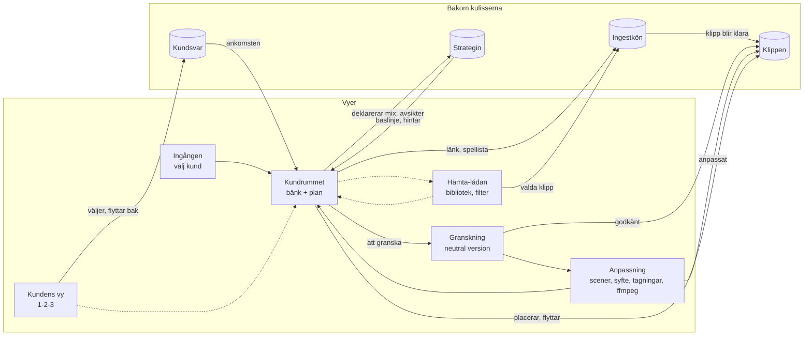

# Kartan

Hur CM-flödet hänger ihop. Kartan har tre lager:

- **Vyer** är det CM ser och gör saker i.
- **Objekt bakom kulisserna** lever vidare oavsett vilken vy som är öppen. En vy *deklarerar* dem eller *läser* dem, men äger dem inte.
- **Kopplingar** visar var nästa del pluggas in.

Wireframen i `app/` är den levande skissen. Kartan beskriver vad den betyder och vad som ska byggas vidare.

## Vyer

| Vy | Jobb | Status |
|---|---|---|
| [Ingången](vyer/ingang.md) | Välj vilken kund passet gäller | Byggd (steg 1) |
| [Kundrummet](vyer/kundrum.md) | Bänken och planen för en kund: se läget, arrangera, ta in nytt | Byggd (steg 1–5) |
| [Granskning](vyer/granskning.md) | Godkänn den neutrala versionen av ett nytt klipp | Port finns ("att granska"), vyn är inte byggd |
| [Anpassning](vyer/anpassning.md) | Gör klippet till kundens: scener, syftesrad, tagningar, ffmpeg | Inte byggd. Nästa stora del |
| [Hämta-lådan](vyer/hamta.md) | Hämta från biblioteket och eget urval, snabbfiltrera | Pin |
| [Kundens vy](vyer/kundens-vy.md) | Kunden väljer 1-2-3, flyttar bak, säger nej | Bara simulerad i ankomsten |

## Bakom kulisserna

| Objekt | Vad det är | Deklareras från | Läses av |
|---|---|---|---|
| [Ingestkön](bakom/ingestkon.md) | Klipp som hämtas och analyseras, ett i taget, oavsett vy | Kundrummet, Hämta-lådan | Kundrummet (bänken), Granskning |
| [Strategin](bakom/strategi.md) | Mixens baslinje, typer, serier, avsikter, tempo | Kundrummet (balans, avsiktsruta), över tid ur publicerat | Kundrummet, harnessen, Kundens vy |
| [Klippen](bakom/klipp.md) | Ett klipps livscykel från original till publicerat | Alla vyer skriver sin del | Alla vyer |
| [Kundsvar](bakom/kundsvar.md) | Vad kunden har gjort sedan sist | Kundens vy | Kundrummet (ankomsten) |

## Kategorier

Egna rum som testas isolerat och bakas in i helheten senare. Videodelen har sedan 2 nov 2026 en egen kopia i `video/` (port 5181) där arbetet fortsätter, medan wireframen i `app/` står pågående och fryst.

| Kategori | Jobb | Status |
|---|---|---|
| [Videoförändring](videoforandring/README.md) | Definiera och kalibrera vertikaler som ett klipp rör sig längs. Föregångare till regibordet | Reglaget i `#v`, galleriet i `#vgalleri` |
| [Biblioteket](videoforandring/bibliotek.md) | Riktiga klipp nedbrutna lokalt: scener, dynamik, kroppar, händer, saker, kamera. Granskning och rättelser som facit | 26 klipp i `#bibliotek` |
| [Kalibrering](videoforandring/kalibrering.md) | Centrala vertikaler tränas på parvisa bedömningar av riktiga scener; Jev mäts mot samma svar; grind till kombinerade | `#kalibrering` |
| [Bryggan](videoforandring/brygga.md) | Motorns mätning jämförd med analysen av samma manus, renderat; korrektion där det håller | `#brygga`: kameran håller (r 0,91), dockorna begränsar resten |
| **[Inlärningen](videoforandring/inlarning.md)** | Vad som förändras per klipp: klipp, profil, ram och CM:s instruktion; norm, täckningskarta och lösare, förankrat i publicerade system | Utkast 2 nov, inget byggt |
| **[Läge och nästa steg](videoforandring/NASTA.md)** | Var arbetet stannade 1 nov 00:15, vad som är användbart nu, hur pågående jobb startas om, nästa steg i ordning | börja här |
| **[Plan efter granskningen](videoforandring/plan.md)** | 2D på originalvideon som bas, 3D selektivt; rätta mätfel; acceptans och kalibrering med bedömningar | gäller från 31 okt 2026 |
| [Rekonstruktion](videoforandring/rekonstruktion.md) | Riktigt klipp → manus (personer, rörelser, kamera, lokal med ren skiva), mätt med samma analys | `#rekon/<id>`, `#v/<id>`; kebab 81 % |
| [Banken](videoforandring/bank.md) | Profiler → förurval ur metadata → nedladdning → Gemini-sållning → urval för träning | `npm run profiler / forurval / sallning / urval` |
| [Typer och takter](videoforandring/typer.md) | Gemini föreslår innehållstyper och scenfunktioner ur biblioteket och märker takter i tid, som grund för skyddsräcken | 4 typer på 26 klipp; för få klipp per typ för gränser än |

## Övrigt

- [Beslut](beslut.md): vad vi har bestämt och varför, i ordning.
- [Pins](pins.md): öppna frågor, sorterade efter vilken del de hör till.
- [Arbetssätt](arbetssatt.md): hur vi bygger. En del i taget och wireframe före kod.

## Steg i wireframen

`app/src/step.js` styr vad som syns. Öppna `localhost:5180/#1` … `#6`.

| Steg | Innehåll | Kartan |
|---|---|---|
| 1 | Ingång, bänk, plan, svag historik | [Ingången](vyer/ingang.md), [Kundrummet](vyer/kundrum.md) |
| 2 | Ankomsten: det kunden gjort sedan sist spelas upp | [Kundsvar](bakom/kundsvar.md) |
| 3 | Mixspår, balans, drag och högerklick | [Strategin](bakom/strategi.md) |
| 4 | Trion 1-2-3 | [Klippen](bakom/klipp.md#trion) |
| 5 | Nytt klipp in, kö, granskning | [Ingestkön](bakom/ingestkon.md) |
| 6 | Harnessen svarar (gammalt, inte omarbetat) | [Strategin](bakom/strategi.md#harnessen) |
